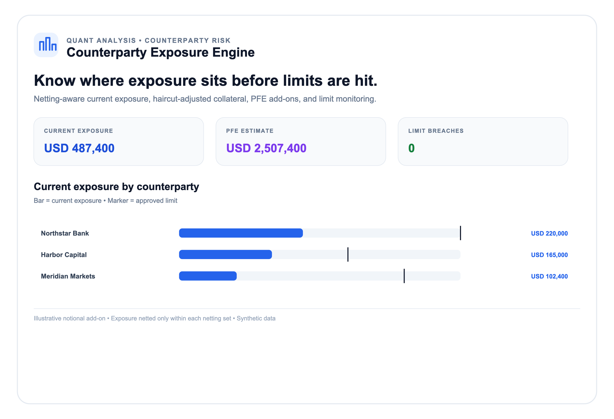
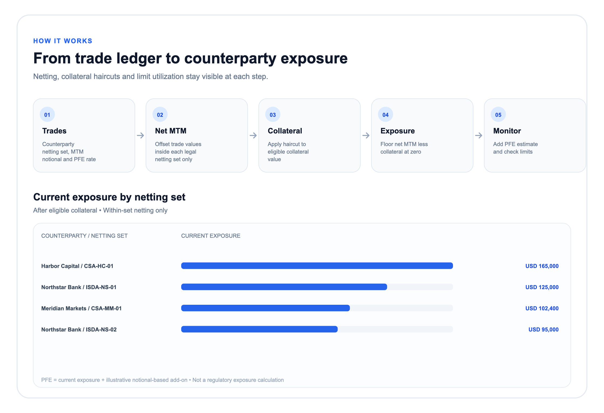

# Counterparty Exposure Engine

A small, auditable counterparty exposure calculator. It nets mark-to-market
values within explicitly identified netting sets, recognizes collateral after
haircuts, estimates a simple potential future exposure (PFE) add-on, and
compares current exposure with counterparty limits.

## Calculation

For netting set \(n\):

```text
net MTM(n) = sum(trade MTM in n)
eligible collateral(n) = sum(collateral amount * (1 - haircut))
current exposure(n) = max(net MTM(n) - eligible collateral(n), 0)
PFE add-on(n) = sum(trade notional * trade add-on rate)
PFE(n) = current exposure(n) + PFE add-on(n)
```

Exposure is then summed across a counterparty's netting sets. Negative MTM is
netted only inside its own netting set. The simple PFE add-on is deliberately
transparent and is not a regulatory SA-CCR calculation, expected exposure
profile, CVA, or default probability model.

## Quickstart

Requires Python 3.10 or later. No third-party runtime packages are required.

```bash
python -m pip install -e .
counterparty-exposure examples/portfolio.json
counterparty-exposure examples/portfolio.json --format json
counterparty-exposure examples/portfolio.json --format svg --chart project > reports/project-overview.svg
counterparty-exposure examples/portfolio.json --format svg --chart flow > reports/exposure-flow.svg
```

Run tests:

```bash
python -m unittest discover -s tests -v
```

## Project screenshots

Both screenshots use a white background and include a chart. They are generated
from the synthetic sample portfolio; PNGs are convenient to view and SVGs are
the scalable source files.





Regenerate the SVG sources after changing the example input:

```bash
mkdir -p reports
counterparty-exposure examples/portfolio.json --format svg --chart project > reports/project-overview.svg
counterparty-exposure examples/portfolio.json --format svg --chart flow > reports/exposure-flow.svg
```

## Input format

See [`examples/portfolio.json`](examples/portfolio.json). Each trade has a
counterparty, a netting set, a product label, signed MTM, notional, and PFE
add-on rate. Each collateral record belongs to one netting set and has a
nominal amount and haircut. A limit must be supplied for each counterparty.

Amounts are assumed to already use the report currency; the engine does not
perform FX conversion. Collateral is only netted within its specified netting
set. The input is synthetic and illustrative, not a statement of real
counterparty exposures.

## Python API

```python
from counterparty_exposure import CounterpartyExposureEngine, Collateral, Trade

engine = CounterpartyExposureEngine(
    currency="USD",
    trades=[
        Trade("swap-1", "Bank A", "ISDA-1", "Rates", 125_000, 5_000_000, 0.02),
        Trade("swap-2", "Bank A", "ISDA-1", "Rates", -40_000, 3_000_000, 0.02),
    ],
    collateral=[Collateral("csa-1", "Bank A", "ISDA-1", 50_000, 0.05)],
    limits={"Bank A": 500_000},
)

report = engine.run()
print(report.counterparties["Bank A"].current_exposure)
print(report.counterparties["Bank A"].limit_utilization)
```

## Guardrails and limitations

- Validates identifiers, finite amounts, haircut bounds, add-on rates, and
  counterparty/netting-set references.
- Does not offset exposure across separate netting sets or counterparties.
- Collateral value is reduced by the supplied haircut; excess collateral does
  not create negative exposure.
- PFE is a simple notional-based illustrative add-on, not a calibrated
  distribution or regulatory exposure method.
- All sample data is synthetic and for demonstration only.
